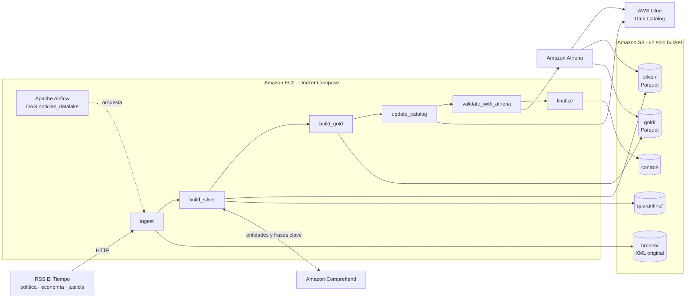

# Data lake de noticias RSS en AWS

Pipeline de datos de extremo a extremo que recopila noticias de tres feeds RSS de El Tiempo, las almacena en un data lake con arquitectura medallón (Bronze, Silver, Gold) en Amazon S3, las enriquece con Amazon Comprehend y las expone para consulta SQL con AWS Glue Data Catalog y Amazon Athena. Apache Airflow, ejecutado con Docker Compose en una instancia Amazon EC2, orquesta todo el proceso.

Autores: Tomás Avendaño Parra (data lake). Ingeniería de Datos, Universidad EIA, 2026-2.

## Arquitectura



La EC2 accede a S3, Comprehend, Glue y Athena mediante un rol IAM. No hay credenciales guardadas en el código ni en la instancia.

## Estructura del repositorio

```
dags/
  noticias_pipeline.py      DAG principal (10 tareas)
  smoke_test_aws.py         DAG de verificación del entorno
  config/
    pipeline.yaml           bucket, región, base de Glue, límites de Comprehend
    sources.yaml            medio, sección y URL de cada feed
  datalake/
    bronze.py               ingesta, manifiestos y estados por fuente
    silver.py               parseo, limpieza, validación, deduplicación, versiones
    enrich.py               Comprehend, caché por hash y tablas de entidades y frases
    gold.py                 agregaciones
    catalog.py              registro de tablas y particiones en Glue
    athena.py               ejecución de consultas y validaciones
    run_sql.py              ejecuta los archivos de dags/sql
    scenarios.py            lotes controlados y fallos para los escenarios de prueba
  sql/                      consultas de Athena entregables
infra/
  iam_policy.json           política de mínimo privilegio para el rol de la EC2
  setup_ec2.sh              instala Docker y levanta Airflow 3.3.0
tests/                      33 pruebas unitarias (pytest + moto)
docs/                       documentación
  evidencias/               capturas de la ejecución en AWS y de los escenarios
```

## Documentación

1. [Arquitectura y decisiones técnicas](docs/01_arquitectura.md)
2. [Fuentes y diccionario de datos](docs/02_fuentes_y_diccionario.md)
3. [Reglas de calidad, identificación y actualización](docs/03_reglas_calidad.md)
4. [Incrementalidad y recuperación](docs/04_incrementalidad_recuperacion.md)
5. [Despliegue, ejecución y eliminación](docs/05_despliegue.md)
6. [Costos y seguridad](docs/06_costos_seguridad.md)
7. [Escenarios de prueba y evidencias](docs/07_escenarios.md)

## Resultados

- 3 feeds de El Tiempo ingeridos cada 2 horas. 98 noticias vigentes al cierre de las pruebas, todas enriquecidas.
- 8 escenarios de la sección 4.5 demostrados con evidencia: carga inicial, registros defectuosos, repetición de un lote, lote incremental, noticia modificada, fallo controlado y reejecución, reprocesamiento desde Bronze y nueva partición.
- 7 validaciones de calidad en Athena en cada ejecución, incluida la conciliación de Gold contra Silver.

## Inicio rápido

1. Crear el bucket, la política, el rol y la EC2 según [docs/05_despliegue.md](docs/05_despliegue.md).
2. En la EC2, clonar el repositorio, escribir el nombre del bucket en `dags/config/pipeline.yaml` y ejecutar `bash infra/setup_ec2.sh`.
3. Abrir Airflow por túnel SSH en `http://localhost:8080` y ejecutar el DAG `noticias_datalake`.

## Pruebas

```bash
pip install apache-airflow-task-sdk boto3 moto pyarrow pyyaml requests pytest pyparsing
pytest -q
```
