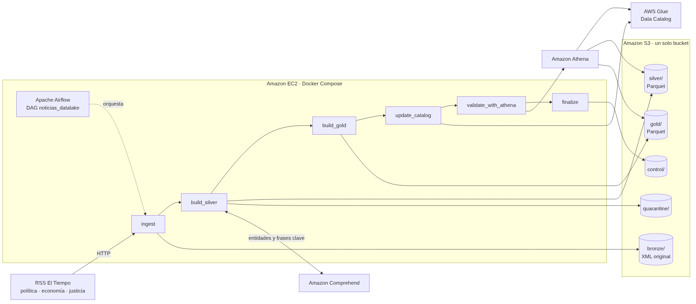

# 1. Arquitectura y decisiones técnicas



## Componentes

| Componente | Servicio | Función |
|---|---|---|
| Fuentes | RSS de El Tiempo | Tres feeds: política, economía y justicia |
| Orquestación | Apache Airflow 3.3.0 en Amazon EC2 (Docker Compose) | Ejecuta el DAG, reintentos, logs y parámetros |
| Almacenamiento | Amazon S3 | Un solo bucket con todas las zonas del data lake |
| Enriquecimiento | Amazon Comprehend | Personas, organizaciones, lugares y frases clave |
| Catálogo | AWS Glue Data Catalog | Tablas, columnas, formato y particiones |
| Consulta | Amazon Athena | SQL sobre Silver y Gold, validaciones de calidad |
| Permisos | AWS IAM | Rol de la EC2 con política de mínimo privilegio |

## Organización del bucket

```
s3://<bucket>/
├── bronze/source=<fuente>/ingestion_date=AAAA-MM-DD/run_id=<lote>/
│       feed.xml            respuesta original del RSS
│       manifest.json       metadatos del lote por fuente
├── silver/
│   ├── news/version=<v>/pub_date=AAAA-MM-DD/part-0.parquet
│   ├── news_entities/version=<v>/pub_date=AAAA-MM-DD/part-0.parquet
│   ├── news_key_phrases/version=<v>/pub_date=AAAA-MM-DD/part-0.parquet
│   ├── _enrichment_cache/text_hash=<sha256>.json
│   └── _state/current.json     puntero a la versión vigente
├── gold/
│   ├── news_daily/version=<v>/pub_date=.../
│   ├── entity_daily/version=<v>/pub_date=.../
│   ├── key_phrase_section_daily/version=<v>/pub_date=.../
│   └── _state/current.json
├── quarantine/
│   ├── bronze/source=<fuente>/run_id=<lote>/response.bin    respuestas inválidas
│   └── silver/run_id=<lote>/rejected.jsonl                  registros rechazados
├── control/
│   ├── runs/run_id=<lote>/ingestion_*.json, silver_*.json, final_*.json
│   └── fail_injection/        marcas para el escenario de fallo controlado
└── athena-results/
```

## DAG `noticias_datalake`

```
validate_config → resolve_batch ─┐
               → list_sources  ──┴→ ingest [una por fuente] → register_ingestion
→ build_silver → build_gold → update_catalog → validate_with_athena → finalize
```

| Tarea | Responsabilidad |
|---|---|
| `validate_config` | Valida `sources.yaml` y el acceso a S3, Glue, Athena y Comprehend |
| `resolve_batch` | Define el lote: nuevo, reprocesamiento o reconstrucción |
| `list_sources` | Lee las fuentes configuradas |
| `ingest` | Descarga cada feed y escribe en Bronze. Una instancia por fuente (dynamic task mapping) |
| `register_ingestion` | Registra el resultado de la ingesta: complete, partial o failed |
| `build_silver` | Limpia, valida, deduplica, enriquece y publica Silver |
| `build_gold` | Construye las agregaciones de Gold |
| `update_catalog` | Crea o actualiza tablas y particiones en Glue |
| `validate_with_athena` | Ejecuta 7 validaciones de calidad con Athena |
| `finalize` | Siempre se ejecuta. Registra el estado final del lote en `control/` |

Configuración del DAG:
- Programación cada 2 horas (`0 */2 * * *`), sin catchup.
- `max_active_runs=1` para evitar escrituras concurrentes sobre el mismo estado.
- 2 reintentos por tarea con 1 minuto de espera.
- Parámetros: `reprocess_run_id` y `rebuild_from_bronze`.

## Decisiones técnicas

**Un solo bucket con prefijos.** Lo pide el taller. Además permite una política IAM limitada a un único recurso.

**Bronze en XML original.** Se guarda la respuesta tal como llegó para reprocesar sin volver a consultar los RSS. El manifiesto registra el estado HTTP, el hash SHA-256 del contenido, la fecha de ingesta en UTC y la ubicación del archivo.

**Silver y Gold en Parquet.** Es un formato columnar y comprimido (snappy) que Athena lee de forma eficiente. Los tipos quedan definidos en el archivo.

**Partición por `pub_date`.** Las consultas del taller filtran por fecha de publicación. Las noticias sin fecha válida van a la partición `pub_date=unknown`.

**Versiones completas y puntero.** Cada ejecución escribe una versión completa de Silver y de Gold en una carpeta nueva. Al final actualiza el puntero `_state/current.json` y mueve las particiones de Glue a la versión nueva. Una ejecución que falla a mitad de camino no deja resultados parciales visibles. Se conservan las 3 últimas versiones.

**Recalcular el estado completo en cada ejecución.** El volumen es pequeño (decenas a cientos de noticias). Reescribir el estado vigente es simple y hace que la idempotencia sea fácil de verificar. Lo costoso, que son las llamadas a Comprehend y la descarga de los RSS, sí es incremental.

**Registro de Glue por API, sin crawler.** La tarea `update_catalog` define las tablas de forma explícita y sincroniza las particiones con el puntero vigente: crea las nuevas, actualiza la ubicación de las existentes y elimina las que ya no existen. Así los metadatos se actualizan en cada ejecución sin depender de la inferencia de un crawler.

**Airflow con Docker Compose.** Se usa el `docker-compose.yaml` oficial de Airflow 3.3.0 (CeleryExecutor, PostgreSQL y Redis). Es reproducible con un script. La instancia es m7i-flex.large (2 vCPU, 8 GB), porque Airflow necesita al menos 4 GB.
