# 7. Escenarios de prueba y evidencias

Comandos usados (en la EC2, dentro de `~/datalake-noticias`):

```bash
alias dl='docker compose exec -e PYTHONPATH=/opt/airflow/dags airflow-worker python -m datalake.scenarios'
alias sql='docker compose exec -e PYTHONPATH=/opt/airflow/dags airflow-worker python -m datalake.run_sql'
```

Los lotes de prueba de los escenarios 2 y 5 son copias controladas de un RSS ya almacenado en Bronze, como permite el taller. Quedan marcados en su manifiesto con `controlled_copy: true` y la ruta del archivo original en `copied_from`.

## 1. Carga inicial

**Resultado esperado:** datos disponibles en Bronze, Silver y Gold, y consultables en Athena.

**Procedimiento:** Trigger del DAG en modo nuevo.

**Resultado obtenido:**
- Primera ingesta: lote `20261104T043235_363518`, estado complete, 10 items por feed.
- DAG completo con las 10 tareas en verde.
- Las consultas de Athena responden las 4 preguntas. La conciliación Gold vs Silver coincide en todas las filas.

**Evidencias:**

Primera ingesta a Bronze (fase inicial del DAG):

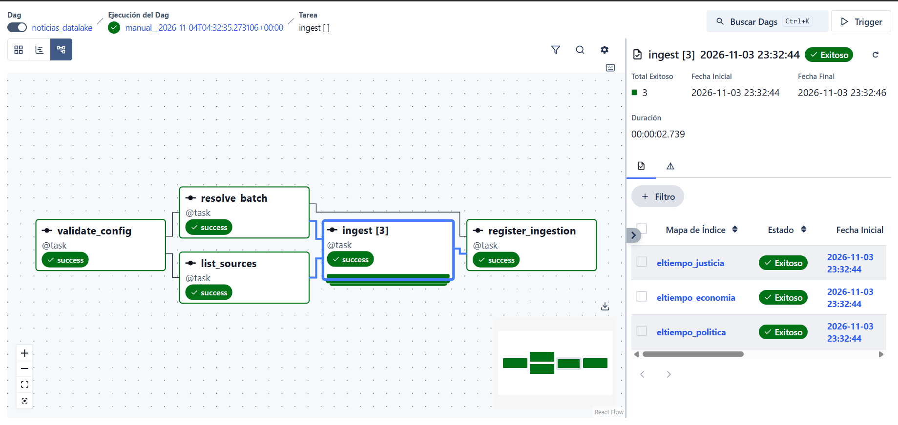

Registro de control del lote y un item del RSS guardado en Bronze:

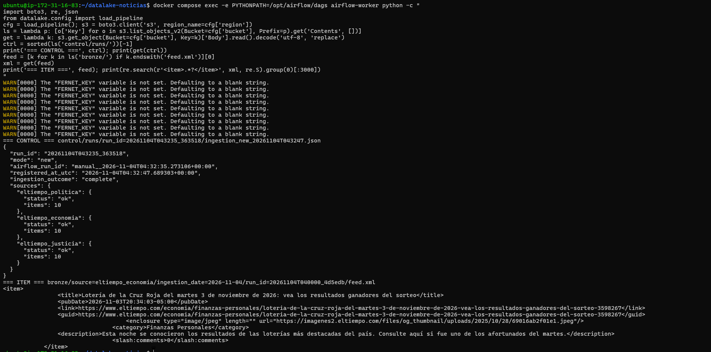

DAG completo con las 10 tareas en verde:

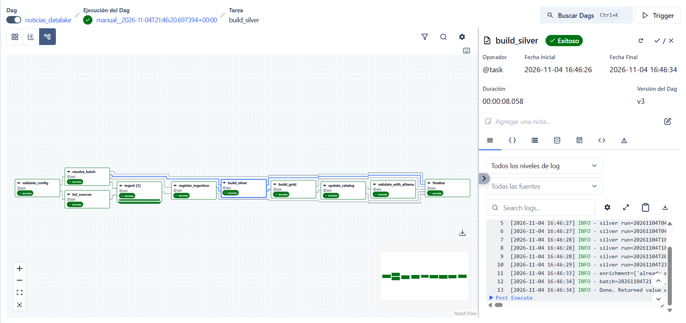

Estructura del bucket:

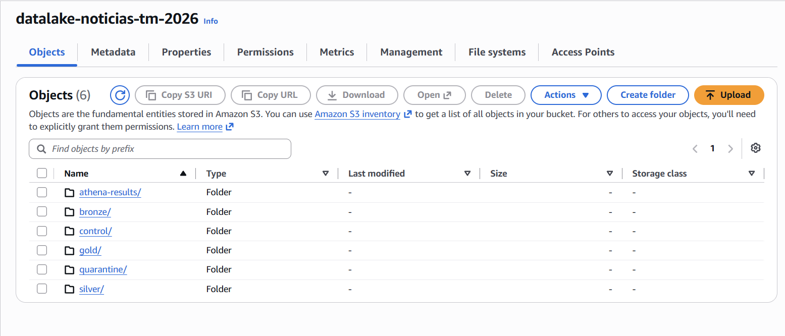

Tablas registradas en Glue:

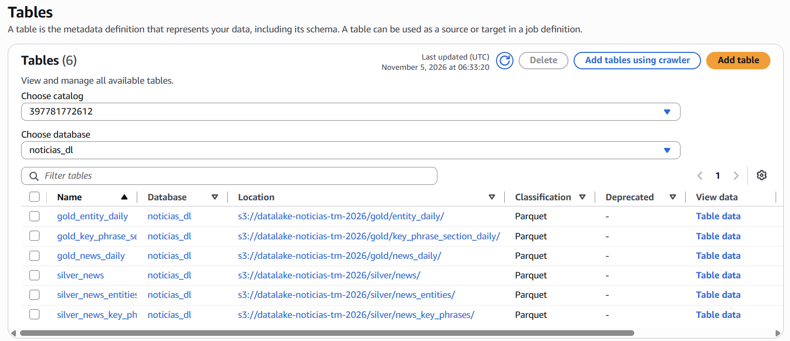

Resultados de las consultas de Athena (`dags/sql/01` a `09`):

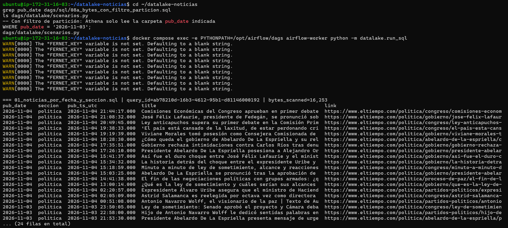
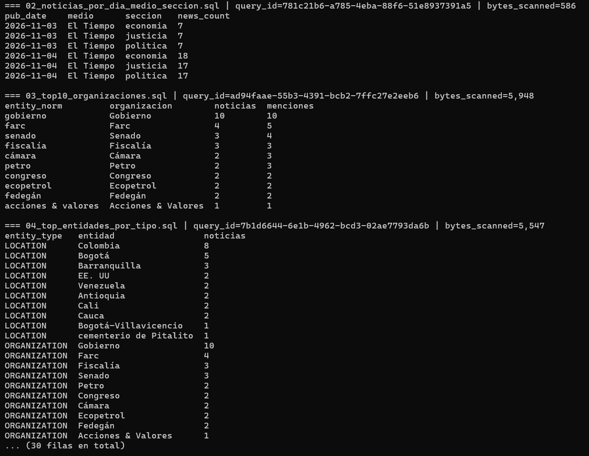
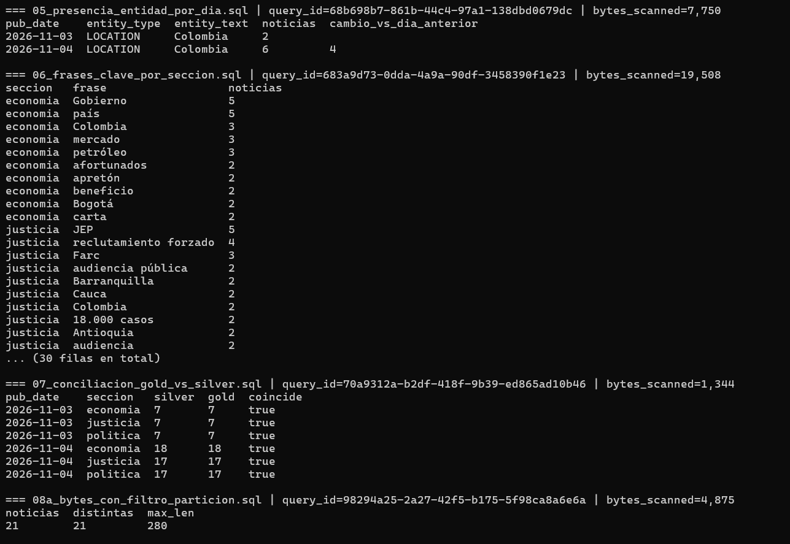
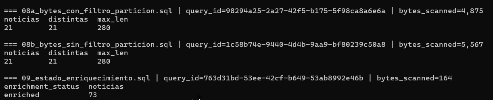

## 2. Registros defectuosos

**Resultado esperado:** rechazos identificados, con motivo y trazabilidad hasta Bronze.

**Procedimiento:**
1. `dl lote-defectuoso`. Crea un lote con una copia del feed de una fuente, en el que el item 0 tiene título vacío, el item 1 un enlace inválido, el item 2 una fecha inválida y el item 3 está duplicado.
2. Trigger con `reprocess_run_id` = el lote creado.
3. `dl lote <lote>`.

**Resultado obtenido:** lote controlado `20261105T060108_testdef`, con el feed de política modificado (11 items: los 10 originales más 1 duplicado).
- `received: 31, valid: 29, rejected: 2`
- `unique_in_batch: 28, duplicates_in_batch: 1`
- `new: 0, updated: 0, repeated: 28`. Noticias vigentes antes y después: 98 → 98.
- Cuarentena `quarantine/silver/run_id=20261105T060108_testdef/rejected.jsonl`:
  - `eltiempo_politica item=0 motivo=titulo_vacio`
  - `eltiempo_politica item=1 motivo=enlace_invalido`
  - Cada rechazo incluye `bronze_uri` (el `feed.xml` del lote) y el XML original del item, así que es trazable hasta Bronze.
- El item con fecha inválida no se rechazó, porque título y enlace eran válidos. Como la noticia ya existía con una fecha válida, conservó su fecha.
- Los manifiestos del lote muestran `controlado=True`.
- Estado final del lote: complete. Las validaciones de Athena pasaron.

**Evidencia:**

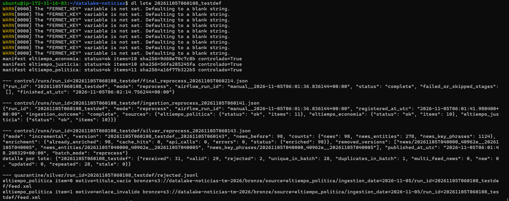

## 3. Repetición de un lote exitoso

**Resultado esperado:** sin duplicados en Silver ni doble conteo en Gold.

**Procedimiento:**
1. `dl estado` para elegir un lote ya procesado.
2. Trigger con `reprocess_run_id` = ese lote.
3. Log de `build_silver` y `sql /opt/airflow/dags/sql/07_conciliacion_gold_vs_silver.sql`.

**Resultado obtenido:** reprocesamiento del lote `20261105T040000_40962e`, que ya había sido procesado por una ejecución programada.
- `received: 30, valid: 30, rejected: 0`
- `new: 0, updated: 0, repeated: 30, stale: 0`
- Noticias vigentes antes y después: 92 → 92. Entidades: 255. Frases clave: 1.054.
- Enriquecimiento: `already_enriched: 92, api_calls: 0`. No se llamó a Comprehend.
- Se publicó una versión nueva de Silver con el mismo contenido. Gold y la conciliación no cambiaron.
- En `control/runs/run_id=20261105T040000_40962e/` quedan los registros de las dos ejecuciones: la original (`mode: new`, programada, `status: complete`) y el reprocesamiento (`mode: reprocess`, manual, `status: complete`). El lote de Bronze no se duplicó: sigue habiendo un solo `feed.xml` por fuente.

**Evidencias:**

Log de `build_silver` del reprocesamiento:

```
silver run=20261105T040000_40962e stats={'received': 30, 'valid': 30, 'rejected': 0, 'unique_in_batch': 30, 'duplicates_in_batch': 0, 'multi_feed_news': 0} merge={'new': 0, 'updated': 0, 'repeated': 30, 'stale': 0}
enrichment={'already_enriched': 92, 'cache_hits': 0, 'api_calls': 0, 'errors': 0, 'status': {'enriched': 92}} entities=255 phrases=1054
batch=20261105T040000_40962e silver={'mode': 'incremental', ..., 'news_before': 92, 'counts': {'news': 92, 'news_entities': 255, 'news_key_phrases': 1054}, ..., 'batch_mode': 'reprocess'}
```

Registros de control del lote: ejecución original y reprocesamiento:

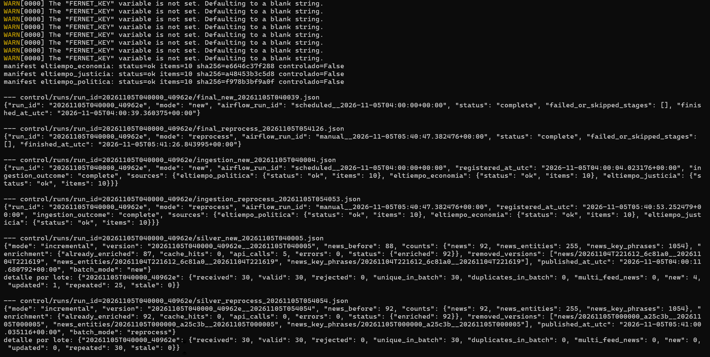

## 4. Nuevo lote incremental

**Resultado esperado:** incorporación de noticias nuevas sin reprocesar innecesariamente las existentes.

**Procedimiento:** Trigger en modo nuevo después de un lote anterior.

**Resultado obtenido:** lote `20261104T213058_ea4d01`:
- `received: 30, valid: 30, rejected: 0, unique_in_batch: 30`
- `new: 8, updated: 1, repeated: 21, stale: 0`
- Silver pasó de 33 a 41 noticias.

Con la caché ya poblada, la ejecución programada del lote `20261105T040000_40962e` muestra que Comprehend solo se llama para lo nuevo o modificado:
- `new: 4, updated: 1, repeated: 25, stale: 0`
- Silver pasó de 88 a 92 noticias.
- Enriquecimiento: `already_enriched: 87, api_calls: 5, errors: 0`. Las 5 llamadas corresponden exactamente a las 4 noticias nuevas y a la 1 modificada.

**Evidencias:**

Log de `build_silver` del lote `20261104T213058_ea4d01`:

```
silver run=20261104T213058_ea4d01 stats={'received': 30, 'valid': 30, 'rejected': 0, 'unique_in_batch': 30, 'duplicates_in_batch': 0, 'multi_feed_news': 0} merge={'new': 8, 'updated': 1, 'repeated': 21, 'stale': 0}
```

El registro `silver_new` del lote `20261105T040000_40962e` aparece en la imagen del escenario 3 (`api_calls: 5`, `new: 4`, `updated: 1`).

## 5. Noticia con contenido modificado

**Resultado esperado:** actualización de la versión vigente y nuevo enriquecimiento solo cuando cambia el texto analizado.

**Procedimiento:**
1. `dl lote-modificado`. Copia los feeds y cambia el título de una noticia (agrega "(ACTUALIZADO)").
2. Trigger con `reprocess_run_id` = el lote creado.
3. Log de `build_silver` y consulta de la noticia en Athena.

**Resultado obtenido:** lote controlado `20261105T060547_testmod`.
- `received: 30, valid: 30, rejected: 0`
- `new: 0, updated: 1, repeated: 29, stale: 0`. Noticias vigentes: 98 → 98.
- Enriquecimiento: `already_enriched: 97, api_calls: 1`. Solo la noticia cuyo texto cambió se volvió a analizar.
- Consulta `10_noticias_modificadas.sql`: la noticia `eltiempo.com-3598453` aparece con `version = 2`, `last_changed_run_id = 20261105T060547_testmod` y `enriched_at_utc` igual a la hora de este lote. Su `first_seen_run_id` sigue siendo el lote real donde apareció por primera vez.
- La misma consulta muestra otras 6 noticias con `version = 2` que El Tiempo modificó de verdad durante las ejecuciones programadas.

Cuando la siguiente ejecución programada trae el feed real, el título vuelve al original. Ese texto ya está en la caché, así que la noticia se actualiza otra vez sin llamar a Comprehend (`cache_hits` en vez de `api_calls`).

Caso real observado: en el lote `20261104T213058_ea4d01` El Tiempo modificó una noticia y el pipeline la clasificó como `updated`.

**Evidencias:**

Log de `build_silver`:

```
silver run=20261105T060547_testmod stats={'received': 30, 'valid': 30, 'rejected': 0, 'unique_in_batch': 30, 'duplicates_in_batch': 0, 'multi_feed_news': 0} merge={'new': 0, 'updated': 1, 'repeated': 29, 'stale': 0}
enrichment={'already_enriched': 97, 'cache_hits': 0, 'api_calls': 1, 'errors': 0, 'status': {'enriched': 98}} entities=278 phrases=1126
```

Noticias con `version > 1` en Athena:

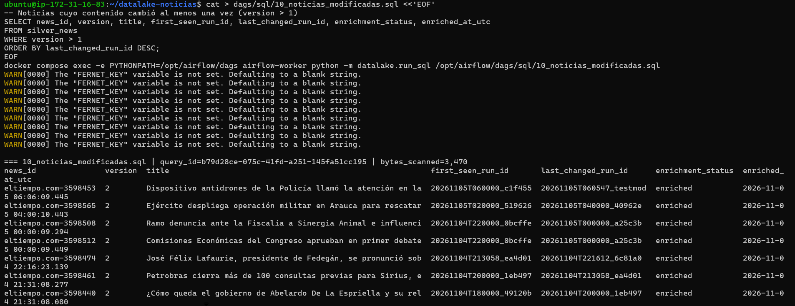

## 6. Fallo controlado y reejecución

**Resultado esperado:** recuperación sin pérdida ni duplicación de resultados.

**Procedimiento:**
1. `dl fallo-activar silver_before_publish`. `build_silver` fallará después de escribir los archivos y antes de publicar el puntero.
2. Trigger en modo nuevo. `build_silver` falla después de sus reintentos. Las etapas siguientes quedan en `upstream_failed` y `finalize` registra el lote como failed.
3. `dl estado`: el puntero de Silver sigue en la versión anterior. Athena muestra los mismos conteos que antes del fallo.
4. `dl fallo-quitar silver_before_publish`.
5. En Airflow, Clear sobre `build_silver` (con sus tareas siguientes). El lote termina en verde.
6. `dl lote <lote>` y la conciliación en Athena.

**Resultado obtenido:** lote `20261105T061053_dfa304` (ejecución `manual__2026-11-05T06:10:53`).
- `build_silver` falló en sus 3 intentos con `RuntimeError: Fallo controlado activo en la etapa 'silver_before_publish'`. El log muestra que el lote se procesó (`received: 30, valid: 30`) antes de fallar, es decir, el fallo ocurrió después de escribir los archivos y antes de publicar el puntero.
- Las etapas siguientes quedaron en `upstream_failed`. `finalize` registró 3 veces `status: failed` con `failed_or_skipped_stages: [build_silver, build_gold, update_catalog, validate_with_athena]`.
- Durante el fallo, `dl estado` mostró la misma versión vigente de Silver y Gold que antes (98 noticias). Los archivos escritos por los intentos fallidos no fueron visibles en Athena.
- Después de quitar la marca de fallo y hacer Clear de `build_silver` con Downstream, la misma ejecución terminó en verde:
  - `silver_new`: `new: 0, repeated: 29, stale: 1`. Noticias 98 → 98. `api_calls: 0`.
  - `stale: 1`: entre el fallo y la recuperación se procesó un lote más reciente. Una noticia de este lote ya tenía una versión posterior y no se sobrescribió con la anterior.
  - `removed_versions` incluye `20261105T061053_dfa304__20261105T061204`, la carpeta que dejó un intento fallido sin publicar. La limpieza la eliminó.
  - Cuarto registro final: `status: complete`, `failed_or_skipped_stages: []`, con el mismo `airflow_run_id`.

**Evidencias:**

DAG con el fallo controlado:

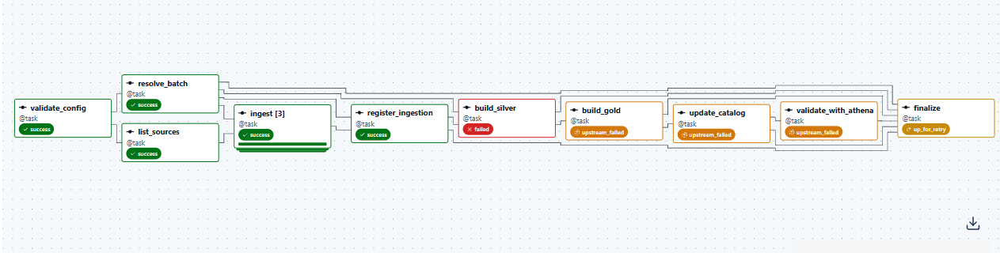

Log de `build_silver` con los 3 intentos y el error:

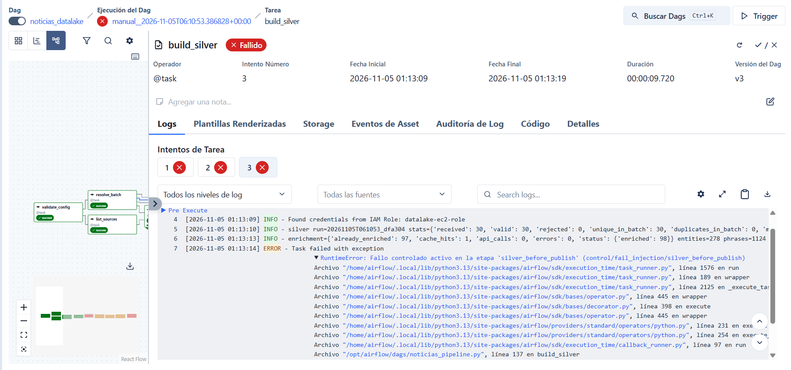

Estado antes y durante el fallo: la versión vigente no cambia y el fallo aparece activo:

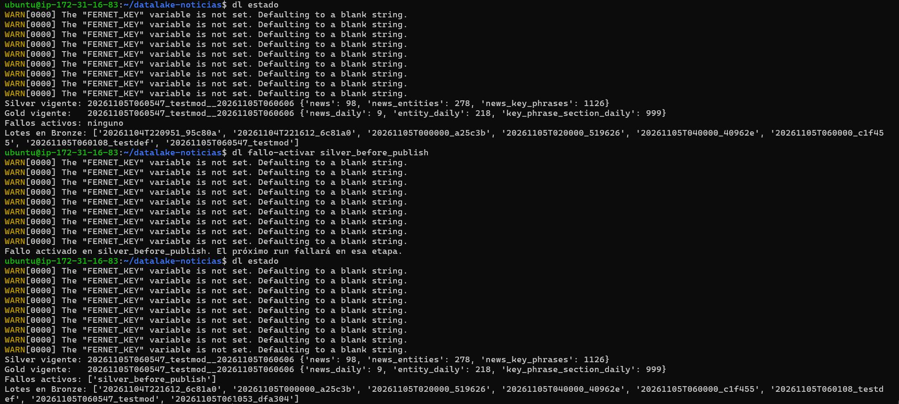

Misma ejecución recuperada con Clear:

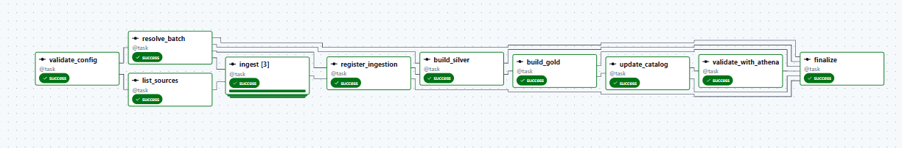

Registros de control del lote: 3 `failed` y 1 `complete`:

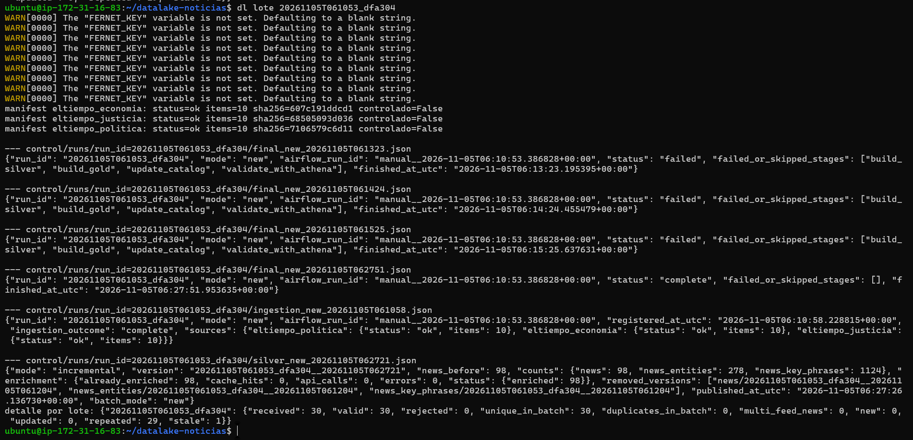

## 7. Reprocesamiento desde Bronze

**Resultado esperado:** reconstrucción de resultados sin volver a consultar los RSS.

**Procedimiento:** Trigger con `rebuild_from_bronze = true`.

**Resultado obtenido:**
- Las tareas `ingest` leen los manifiestos de Bronze. No hay peticiones HTTP.
- `build_silver` recorre los lotes de Bronze en orden (una línea `silver run=` por lote).
- Enriquecimiento: `cache_hits: 41, api_calls: 29, errors: 0`, con 70 noticias enriquecidas. Las 29 llamadas corresponden a noticias que solo existían en lotes anteriores a la incorporación de Comprehend.

**Evidencia:** DAG en verde. En el log de `build_silver` se ve una línea `silver run=` por cada lote de Bronze.


## 8. Nueva partición

**Resultado esperado:** datos disponibles en Athena después de actualizar los metadatos.

**Procedimiento:** cuando aparece una fecha de publicación nueva, `update_catalog` crea su partición en Glue en la misma ejecución.

**Resultado obtenido:**
- La tabla `silver_news` en Glue tiene 3 particiones: 2026-11-03, 2026-11-04 y 2026-11-05.
- `CreationTime` de 2026-11-03 y 2026-11-04: 2026-11-04 21:46:40 UTC, la primera ejecución con `update_catalog`.
- `CreationTime` de 2026-11-05: 2026-11-05 02:00:20 UTC. La creó automáticamente la ejecución programada de las 02:00 UTC (lote `20261105T020000_519626`), la primera que trajo noticias publicadas ese día. No hubo intervención manual ni crawler.
- Las 3 particiones apuntan a la misma versión vigente (`version=20261105T061053_dfa304__20261105T062721`). En cada ejecución `update_catalog` mueve las particiones existentes a la versión nueva.
- Consulta `11_noticias_por_particion.sql`: Silver y Gold muestran las mismas 3 fechas con los mismos conteos (21, 56 y 21 noticias).

**Evidencias:**

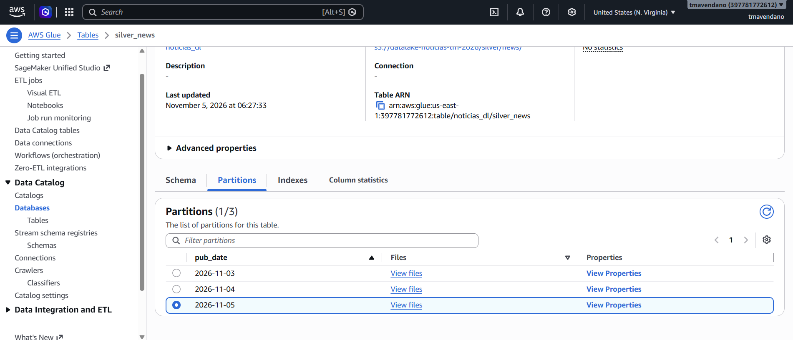

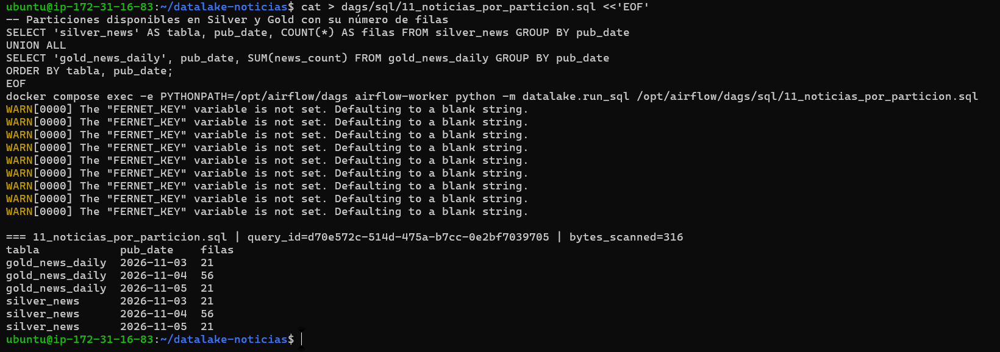

## Ejecución programada

El DAG se ejecutó automáticamente cada 2 horas durante el laboratorio (`scheduled__...`). Todas las ejecuciones terminaron en estado exitoso.

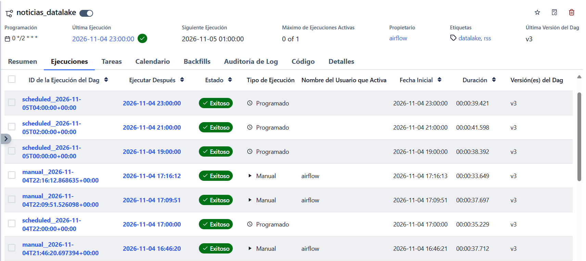

## Comparación de bytes escaneados

| Consulta | Filtro | Bytes escaneados |
|---|---|---|
| 08a | `pub_date = '2026-11-03'` (partición) | 4.875 |
| 08b | `date_format(pub_ts_utc, '%Y-%m-%d') = '2026-11-03'` (columna) | 5.567 |

Las dos devuelven 21 noticias. Con filtro de partición, Athena solo abre la carpeta de esa fecha. Sin él, abre todas las particiones y lee la columna `pub_ts_utc` para filtrar. La diferencia es pequeña porque en el momento de la medición había solo 2 fechas y pocos datos, y parte de lo leído son metadatos fijos de cada archivo Parquet. El costo de la consulta sin filtro crece con el número de días almacenados. El de la consulta con filtro no.
