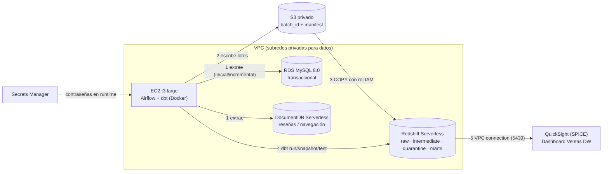

# Data Warehouse en AWS

Migración del proyecto local [DE-DW](docs/README_local.md) (MySQL + MongoDB → DuckDB + dbt + Airflow) a AWS:
RDS MySQL y DocumentDB → S3 → Redshift (dbt) → QuickSight, orquestado con Airflow en EC2.

| Paso | Contenido | Estado |
|---|---|---|
| 1 | Infraestructura base con Terraform (`infra/terraform`) | ✔ |
| 2 | Fuentes en RDS y DocumentDB ([diferencias](docs/aws/diferencias_mongodb_documentdb.md)) | ✔ |
| 3 | Extracción inicial/incremental a S3 ([guía](docs/aws/03_extraccion_s3.md)) | ✔ |
| 4–5 | COPY a Redshift, dbt, SCD2 ([guía](docs/aws/04_carga_redshift_dbt.md)) | ✔ |
| 6 | Airflow en la EC2 ([guía](docs/aws/06_airflow_ec2.md)) | ✔ |
| 7 | Evidencias de los 6 escenarios y conciliación ([guía](docs/aws/07_evidencias_escenarios.md)) | ✔ |
| 8 | QuickSight ([guía](docs/aws/08_quicksight.md)) | ✔ |
| 9 | Arquitectura, costos, seguridad y eliminación ([guía](docs/aws/09_arquitectura_costos_seguridad.md)) | ✔ |

## Paso 1 – Infraestructura

```bash
ssh-keygen -t ed25519 -f ~/.ssh/taller-dw -N ""
export AWS_REGION=us-east-1 AWS_DEFAULT_REGION=us-east-1
cd infra/terraform
terraform init
terraform apply -var "my_ip_cidr=$(curl -s ifconfig.me)/32"
cd ../..
```

## Paso 2 – Fuentes en RDS MySQL y DocumentDB

Las bases son privadas (solo se alcanzan desde la EC2). Los scripts leen las contraseñas de Secrets Manager.

```bash
# En tu equipo, desde esta carpeta: genera .env.aws (sin secretos) y copia el proyecto a la EC2
./scripts/aws/sync_to_ec2.sh

# En la EC2
ssh -i ~/.ssh/taller-dw ec2-user@<ec2_public_ip>
cd ~/data-warehouse && ./scripts/aws/ec2_setup_sources.sh
```

Resultado esperado de la verificación (datos por defecto, `--seed 42`): conteos en `customers`, `products`, `orders`, `order_items`, `reviews` y `navigation_events` iguales a los de la guía local [02_fuentes_iniciales](docs/etapas/02_fuentes_iniciales.md).

## Arquitectura


## Eliminación

Guía completa: [paso 9](docs/aws/09_arquitectura_costos_seguridad.md). Verificación: `./scripts/aws/verificar_limpieza.sh`.

`terraform -chdir=infra/terraform destroy -var "my_ip_cidr=0.0.0.0/32"` y luego el checklist de limpieza.
