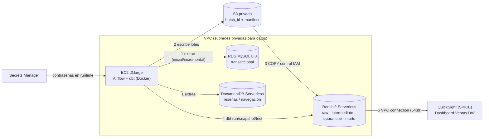

# Paso 9 – Arquitectura, decisiones, costos, seguridad y eliminación

## Arquitectura

Flujo: Airflow (EC2) valida conexiones → extrae de RDS MySQL y DocumentDB (carga inicial o incremental por id) → escribe lotes en S3 privado
(`batch_id` + manifiesto como marca de confirmación) → `COPY` a Redshift Serverless con rol IAM → dbt (intermediate, quarantine, snapshots SCD2, marts, pruebas)
→ registro del resultado → QuickSight (SPICE) sobre `marts.rpt_sales_dashboard` por una VPC connection privada.

## Despliegue y ejecución reproducibles
1. **Mac:** `ssh-keygen -t ed25519 -f ~/.ssh/taller-dw -N ""`; crear `infra/terraform/terraform.tfvars` con la línea `my_ip_cidr = "<tu IP>/32"` (`curl -4 -s ifconfig.me`); `terraform init && terraform apply`.
2. **Mac:** `./scripts/aws/sync_to_ec2.sh` (genera `.env.aws` sin secretos y copia el proyecto).
3. **EC2:** `./scripts/aws/ec2_setup_sources.sh` (siembra las fuentes), `./scripts/aws/ec2_setup_dbt.sh`, `./scripts/aws/ec2_airflow.sh up` (imprime una vez la contraseña de la UI).
4. **EC2:** `./scripts/aws/ec2_airflow.sh trigger` ejecuta el DAG `dw_pipeline`; `status` y `logs` para seguirlo. Escenarios y evidencias: [07](07_evidencias_escenarios.md).
5. QuickSight: [08](08_quicksight.md).

## Decisiones técnicas
- **Redshift Serverless 4 RPU** (mínimo): sin clúster que administrar, pago por uso; privado, contraseña de admin gestionada por Secrets Manager.
- **Manifiesto como marca de confirmación:** un lote sin manifiesto no existe; repetir un lote reutiliza el manifiesto y el cargador lo omite vía `"raw".batch_control` (idempotencia).
- **Cargas transaccionales con Data API** (`batch_execute_statement`): o entra el lote completo o nada.
- **dbt incremental `delete+insert`** con ventana de reproceso y anti-join (Redshift no admite subconsultas correlacionadas ahí).
- **SCD2 con snapshots dbt** (estrategia timestamp) para `dim_customer` y `dim_product`.
- **Airflow LocalExecutor en la misma EC2:** `max_active_runs=1`, 2 reintentos con espera exponencial, `record_result` con `all_done` para registrar también fallos.
- **QuickSight sobre una tabla de marts** con usuario de solo lectura y SPICE (no consulta Redshift en cada clic).

## Diferencias frente al entorno local
| Local | AWS |
|---|---|
| MySQL y MongoDB en Docker | RDS MySQL y DocumentDB ([diferencias](diferencias_mongodb_documentdb.md)) |
| DuckDB como DW | Redshift Serverless (`COPY` desde S3, `convert_timezone`, sin `isodow`, esquema `"raw"` entrecomillado) |
| Archivos locales | S3 privado con lotes y manifiestos |
| Airflow local | Airflow en EC2 + dbt en venv propio |
| Sin BI | QuickSight + SPICE + VPC connection |
| Credenciales en `.env` | Secrets Manager + rol de instancia |

## Estimación de costos (us-east-1, referencial; verifica precios vigentes)
| Recurso | Tarifa aprox. | Uso del taller | Estimado |
|---|---|---|---|
| EC2 t3.large | ~US$0.083/h | encendida todo el taller (~40 h) | ~US$3.5 |
| RDS MySQL db.t4g.micro + 20 GB | ~US$0.016/h | ~40 h | ~US$1 |
| DocumentDB Serverless (mín. 0.5 DCU) | ~US$0.06/h mínimo + almacenamiento | ~40 h | ~US$3 |
| Redshift Serverless 4 RPU | ~US$0.375/RPU-h (US$1.5/h) solo activo, por segundo | ~2–3 h acumuladas de actividad | ~US$3–5 |
| S3 | centavos por GB | < 1 GB | < US$0.1 |
| Secrets Manager | ~US$0.40/secreto/mes | 3–4 secretos | < US$2 |
| QuickSight Enterprise | prueba 30 días; SPICE ~US$0.38/GB/mes | < 1 GB | US$0 en prueba |
| **Total orientativo** | | | **~US$12–15** |
Dejar todo encendido un mes costaría varias veces más (el cargo dominante es EC2+RDS+DocumentDB por hora): **destruir al terminar**.

## Controles de seguridad
- Bases y Redshift **no públicos** (`publicly_accessible=false`); solo accesibles desde la EC2 (y QuickSight por su grupo en 5439).
- SSH solo desde `my_ip_cidr`; Airflow UI solo en `127.0.0.1` (túnel SSH).
- S3 con bloqueo de acceso público, cifrado AES256 y versionado.
- Cifrado en reposo en RDS, DocumentDB y EBS; TLS hacia las bases.
- Contraseñas en Secrets Manager, leídas en ejecución; ninguna en código ni repositorio. `terraform.tfvars`, `.env.aws`, `*.tfstate` fuera de git (`.gitignore`).
- IAM de mínimo privilegio: rol de EC2, rol de Redshift (solo lectura del bucket) y rol de QuickSight (solo interfaces de red). Usuario `quicksight_ro` con SELECT solo en `marts`.
- AWS CLI/Terraform con `user_cli`, nunca root.

## Eliminación (en este orden)
1. **QuickSight (consola):** borrar dashboard, análisis, dataset y VPC connection; *Account settings → Unsubscribe*.
2. **Mac:** `cd infra/terraform && terraform destroy` (si tu IP cambió, usa la actual en `terraform.tfvars`).
3. **Mac:** `./scripts/aws/verificar_limpieza.sh` → todo debe salir vacío.
4. IAM: desactivar/eliminar la clave de acceso de `user_cli` y revisar *Billing → Bills* a las 24 h.
